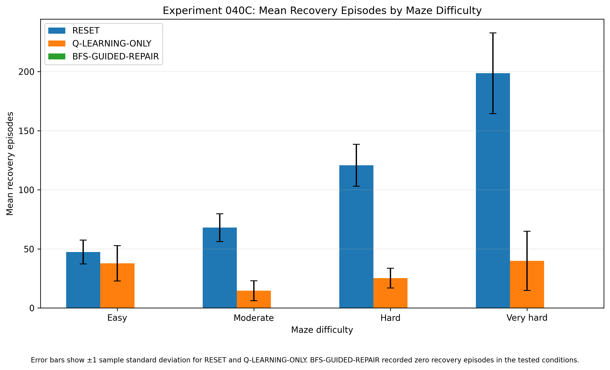

# Project ORBIT — Figures and Visualisations

This directory contains visual representations of experimental findings.

## Planned Visualisations

1. Recovery cost comparison across maze difficulty levels.
2. Recovery performance under repeated environmental changes.
3. Comparison of RESET, Q-LEARNING-ONLY, and BFS-GUIDED-REPAIR.
4. Performance across different maze layouts.
5. Knowledge retention and adaptation trends.

## Purpose

These figures will help communicate experimental findings clearly and make comparisons between adaptation strategies easier to interpret.

## Data Integrity

All figures should be generated from recorded experimental results. Graphs must accurately represent the underlying data, including relevant averages, variability, and evaluation conditions.

No illustrative graph should be presented as an actual experimental result.

---

## Figure 1: Experiment 040C — Recovery Episodes

**Description:** Comparison of mean recovery episodes for RESET, Q-LEARNING-ONLY and BFS-GUIDED-REPAIR across four maze difficulty levels.

**Key observations:**
- Q-LEARNING-ONLY recorded fewer recovery episodes than RESET at every difficulty level.
- BFS-GUIDED-REPAIR recorded zero recovery episodes in the tested conditions.
- Recovery costs generally increased with maze difficulty for RESET.

**Data presentation:** Error bars represent ±1 sample standard deviation for RESET and Q-LEARNING-ONLY.

 
